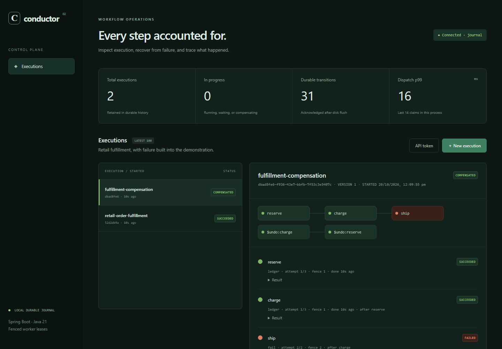

# Conductor

**Durable workflow orchestration for retail fulfillment — Spring Boot 4 (Java 21), React + TypeScript, DynamoDB / SQS / S3 / EventBridge, AWS CDK.**

Conductor executes version-pinned workflow DAGs through retries, approvals, parallel branches, durable timers, and saga compensation. It is inspired by the engineering problems behind AWS Step Functions, not affiliated with Amazon.

The interesting demonstration is a crash between a payment-like effect and its completion acknowledgment. The task runs again; the downstream ledger recognizes the same idempotency key; a stale worker cannot overwrite the new owner's result.



## Two backends, one state machine

| | `CONDUCTOR_STORE=journal` (default) | `CONDUCTOR_STORE=dynamodb` |
|---|---|---|
| State | Checksummed write-ahead log, group-committed `fsync` | DynamoDB: per-execution optimistic transactions |
| Dispatch | In-memory due-time heap, long-poll HTTP workers | Transactional outbox → SQS (with DLQ) |
| Timers | Persisted `readyAt`, heap-ordered | SQS delay ≤ 15 min; longer timers wait in the DynamoDB outbox |
| Large results | Inline | S3, content-addressed (SHA-256), verified on read |
| Lifecycle events | — | EventBridge `Execution Status Change` via the same outbox |
| Scaling | One coordinator, many workers | Stateless API replicas, autoscaled SQS workers |
| Use it for | Local runs, a single box, the crash harness | AWS |

Both backends run the identical pure state machine (`core/Workflow.java`); they differ only in how a transition is made durable and how work is dispatched. See [architecture](docs/architecture.md).

## Run in two minutes

Requires JDK 21+. The Maven wrapper downloads Maven, and the build downloads Node for the console.

```sh
./mvnw package                      # builds console + jar, runs all tests (Windows: mvnw.cmd package)
java -XX:MaxGCPauseMillis=5 -jar target/conductor.jar      # http://127.0.0.1:8080 (JDK 21, or 25.0.4+)
```

Choose **New execution → Retail fulfillment**. Inspect the payment retry, approve the fraud-review step, and watch the two packing branches join before the timer and dispatch. Choose **Compensation demo** to reverse the inventory and payment steps after shipping fails.

Console development with hot reload: `cd console && npm ci && npm run dev` (proxies `/api` to `:8080`).

### Separate worker processes (journal)

```sh
API_TOKEN=$(openssl rand -hex 24) WORKERS=0 java -jar target/conductor.jar                       # coordinator
API_TOKEN=... CONDUCTOR_ROLE=worker COORDINATOR_URL=http://127.0.0.1:8080 java -jar target/conductor.jar   # × N
```

Kill a worker during a `sleep` activity. A replacement claims it after the 3-second lease expires; its attempt and fencing token increase.

### The AWS architecture on one machine

```sh
export API_TOKEN=local-demo-token-at-least-24-chars
docker compose -f compose.localstack.yaml --profile app up --build --scale api=2 --scale worker=2
python scripts/smoke_test.py http://127.0.0.1:8080
```

LocalStack provides DynamoDB, SQS, S3 and EventBridge; nginx round-robins two stateless API replicas. `docker compose up --build --scale worker=2` runs the journal topology instead.

## What is implemented and verified

| Capability | Evidence |
|---|---|
| Durable journal | CRC32C-framed WAL, `force(true)` before acknowledgment, torn-tail truncation, corrupt-frame fail-closed, byte-identical replay (JUnit) |
| DynamoDB transitions | Conditional `version` check + event append + outbox in one `TransactWriteItems`; 12-way concurrent completions on one execution converge (LocalStack JUnit) |
| Outbox | Dispatch survives a crash between commit and send: relay re-delivers (LocalStack JUnit) |
| Fenced leases | Monotonic tokens; owner + fence + live lease checked on every write; stale owners rejected in both backends |
| Worker crash recovery | Kill worker processes/containers mid-activity → reclaimed as attempt 2, fence 2 (integration test, both backends, and Docker) |
| Process crash recovery | 200 seeded child-JVM kills at four acknowledged boundaries: 200/200 completed, 0 duplicate effects |
| Retries, approvals, timers, sagas | Integration tests over real HTTP, both backends |
| Idempotency | Submission keys (journal map / DynamoDB `SUBMIT#` item, race-tested); effect ledger (journal / conditional DynamoDB put) |
| S3 payloads | Results > 32 KiB offloaded, hash-verified on read (integration test) |
| EventBridge | Lifecycle events captured through a rule → SQS tap (integration test) |
| Console | React 19 + TypeScript: live metrics, run list, DAG view, approvals, cancellation (Vitest) |
| Container images | Multi-stage Dockerfile; journal and LocalStack topologies smoke-tested with `docker compose` |
| Infrastructure | CDK: DynamoDB (PITR, deletion protection), SQS + DLQ, private S3, EventBridge bus/archive/rule, internal ALB, 2 API tasks, queue-scaled workers, alarms, dashboard (assertion tests + synth) |

## Performance (one laptop, not AWS)

| | |
|---|---|
| **Peak throughput** | **10,100 durable workflows/s** at 256 concurrent workflows |
| **Latency at one concurrent workflow** | **p50 1.36 ms, p99 5.7 ms** |

Conditions: JDK 21, 4-core laptop, consumer NVMe SSD, write-through journaling, three steps per workflow with two durable effects, every transition durable before acknowledgment. Both numbers come from one sweep. The full throughput-latency curve, the tail decomposition, open-loop latency under load, and why every other figure in the repo is not quoted are in **[docs/benchmark.md](docs/benchmark.md)**.


Engineering write-ups: [scaling study](docs/scaling.md), [latency work](docs/scaling.md#latency), [durability evidence and limits](docs/durability.md), [decision log](docs/decisions.md).

> Runtime note: use JDK 21 or JDK 25.0.4+. JDK 25.0.2 has a virtual-thread timer bug (JDK-8370887) that stalled this service for seconds under load; the service logs a warning on affected builds.

## Not done, stated plainly

- **No AWS deployment or AWS benchmark has been run.** The CDK stack synthesizes and its assertions pass; deploying needs valid credentials (`cd infra && npx cdk deploy`). `scripts/smoke_test.py` and `scripts/load_test.py` are ready to run against the deployed endpoint from inside the VPC.
- The internal ALB listener is HTTP; add an ACM certificate before carrying sensitive data. One shared bearer token; no tenant isolation or RBAC.
- DynamoDB-mode dispatch latency includes SQS delivery and 1-second `DelaySeconds` granularity for timers and lease checks.

## API

`/api/*` requires `Authorization: Bearer …` when `API_TOKEN` is set (mandatory, ≥ 24 chars, for non-loopback binds). Bodies are strict JSON (duplicate keys rejected), ≤ 256 KiB.

| Method | Path | Purpose |
|---|---|---|
| GET | `/healthz` | Liveness + durability (503 after a journal write failure) |
| POST | `/api/executions` | Start; requires `Idempotency-Key` |
| GET | `/api/executions?limit=100` | Latest runs (1..500) |
| GET | `/api/executions/{id}?waitMs=` | Pinned definition, tasks, results; `waitMs` (≤ 30 s) long-polls until terminal |
| POST | `/api/executions/{id}/signal` | `{"step":"fraudReview"}` |
| POST | `/api/executions/{id}/cancel` | Stop scheduling and fence completions |
| GET | `/api/metrics` | Counts, worker dispatch percentiles, ledger effects |
| POST | `/api/worker/{claim,heartbeat,complete,effect}` | Journal-mode worker protocol (long-poll claim) |

Configuration (environment): `PORT`, `BIND_ADDRESS`, `API_TOKEN`, `WORKERS`, `LEASE_MS`, `CONDUCTOR_ROLE` (`coordinator`/`worker`), `CONDUCTOR_STORE` (`journal`/`dynamodb`), `DATA_DIR`, `COORDINATOR_URL`, `JOURNAL_SHARDS` (default 1), `JOURNAL_SYNC` (`write-through` default, or `flush`); for DynamoDB: `AWS_REGION`, `CONDUCTOR_TABLE`, `CONDUCTOR_QUEUE`, `CONDUCTOR_BUCKET`, `CONDUCTOR_EVENT_BUS`, `CONDUCTOR_AWS_ENDPOINT` (emulators), `CONDUCTOR_CREATE_RESOURCES`.

## Verification

```sh
./mvnw package                                          # Java unit/web tests + 7 console tests
python scripts/integration_test.py                      # real HTTP + worker processes, journal
docker compose -f compose.localstack.yaml up -d localstack
CONDUCTOR_IT_AWS_ENDPOINT=http://127.0.0.1:4566 ./mvnw test -Dtest=DynamoEngineIT
python scripts/integration_test.py --store dynamodb     # same scenarios + S3, timers, EventBridge
python scripts/scaling_sweep.py --label mine --config "after="   # throughput vs workers; see docs/scaling.md
java -cp "target/classes:target/test-classes" dev.conductor.tools.ChaosHarness 200 20261020
```

(Windows classpath separator: `;`.) CI runs all of these except the long benchmarks, plus Docker and CDK jobs.

More: [design decisions](docs/decisions.md) · [AWS deployment](docs/aws.md) · [interview notes](docs/interview.md) · [project brief](docs/project-brief.md)
