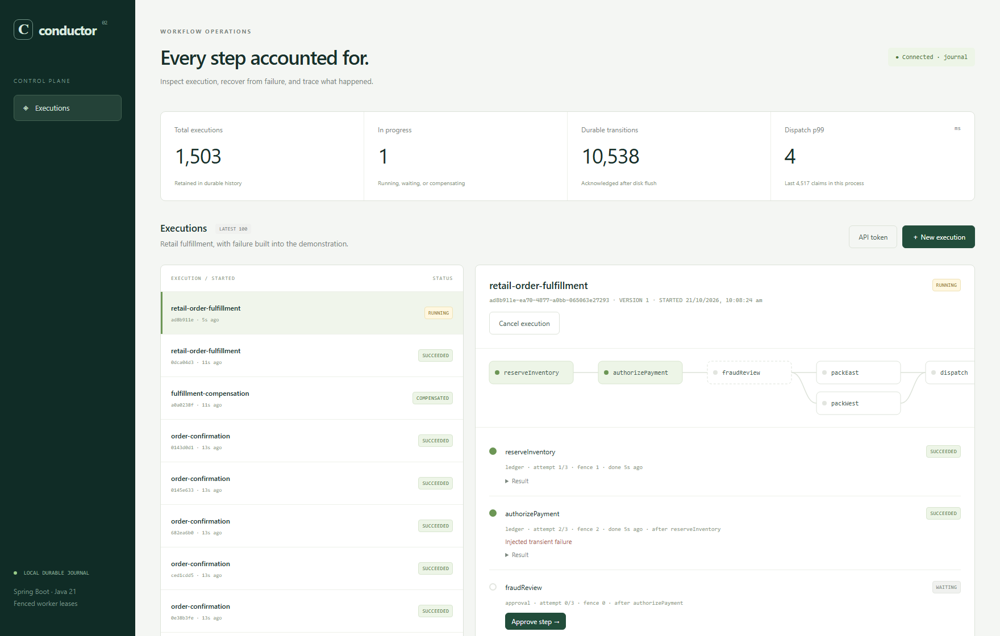
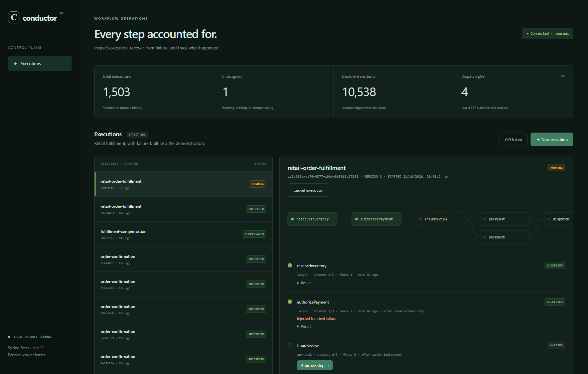

# Conductor

[](https://github.com/likhith2366/distributed-workflow-orchestration-platform/actions/workflows/verify.yml)


**A durable workflow engine: every step of every workflow is on disk before it is acknowledged, workers can die at any moment, and nothing runs twice where it matters.**

Conductor executes version-pinned workflow DAGs through retries, human approvals, parallel branches, durable timers and saga compensation. It runs either on a group-committed write-ahead log or on DynamoDB with SQS, S3 and EventBridge. It is inspired by the engineering problems behind AWS Step Functions, not affiliated with Amazon.

<table>
<tr>
<td align="center"><h2>10,100</h2>durable workflows / second<br><sub>peak, 256 concurrent</sub></td>
<td align="center"><h2>1.36 ms</h2>p50 workflow latency<br><sub>p99 5.7 ms, one in flight</sub></td>
<td align="center"><h2>30 ms</h2>p99 at 8,900 workflows/s<br><sub>128 concurrent</sub></td>
<td align="center"><h2>200 / 200</h2>process kills recovered<br><sub>0 duplicate effects</sub></td>
</tr>
<tr>
<td align="center"><h2>2.75×</h2>throughput vs previous engine<br><sub>same harness, 256 workers</sub></td>
<td align="center"><h2>−77%</h2>unloaded latency<br><sub>4.87 → 1.12 ms, 1 client, same harness</sub></td>
<td align="center"><h2>−66%</h2>bytes written per workflow<br><sub>field-level WAL patches</sub></td>
<td align="center"><h2>3,000</h2>random transitions replayed<br><sub>byte-identical after restart</sub></td>
</tr>
</table>

<sub>One laptop (4-core i5, consumer NVMe), JDK 21, write-through journal, three steps per workflow with two durable effects. Headline numbers: [benchmark report](docs/benchmark.md). Before/after figures: [scaling study](docs/scaling.md). Not AWS numbers.</sub>



<details><summary>Dark mode</summary>



</details>

## How it holds up

| Concurrent workflows | Throughput | p50 | p99 |
|---:|---:|---:|---:|
| 1 | 574 /s | 1.36 ms | 5.7 ms |
| 16 | 2,662 /s | 4.84 ms | 14.9 ms |
| 64 | 6,464 /s | 7.07 ms | 29.3 ms |
| 128 | 8,911 /s | 10.8 ms | 30.5 ms |
| **256** | **10,116 /s** | **20.4 ms** | **50.3 ms** |


- **The knob is concurrency.** From 32 to 128 concurrent workflows, throughput more than doubles while p99 holds at ~30 ms.
- **The tail is understood, not guessed.** Every journal command is timed as queue wait, batch formation and durable write. At low concurrency the tail is the SSD write; from 16 up it is group-commit batching, predictable from batch size. Under open-loop load, p99 stays at ~15 ms up to 50% of capacity and the knee is between 50% and 75% ([latency vs load](docs/benchmark.md#latency-under-open-loop-load)).
- **Crash-safe by construction.** A worker can die after charging a payment but before reporting it: the task is retried under a higher fencing token, the stale worker's late completion is rejected, and the idempotent ledger returns the original result instead of charging twice.

## Two backends, one state machine

| | `CONDUCTOR_STORE=journal` (default) | `CONDUCTOR_STORE=dynamodb` |
|---|---|---|
| State | Checksummed write-ahead log, group-committed `fsync` | DynamoDB: per-execution optimistic transactions |
| Dispatch | In-memory due-time heap, long-poll HTTP workers | Transactional outbox → SQS (with DLQ) |
| Timers | Persisted `readyAt`, heap-ordered | SQS delay ≤ 15 min; longer timers wait in the DynamoDB outbox |
| Large results | Inline | S3, content-addressed (SHA-256), verified on read |
| Lifecycle events | — | EventBridge `Execution Status Change` via the same outbox |
| Scaling | One coordinator, many workers | Stateless API replicas, autoscaled SQS workers |
| Use it for | Local runs, a single box, the crash harness | AWS |

Both backends run the identical pure state machine (`core/Workflow.java`); they differ only in how a transition is made durable and how work is dispatched. See [architecture](docs/architecture.md).

## Run in two minutes

Requires JDK 21+. The Maven wrapper downloads Maven, and the build downloads Node for the console.

```sh
./mvnw package                      # builds console + jar, runs all tests (Windows: mvnw.cmd package)
java -XX:MaxGCPauseMillis=5 -jar target/conductor.jar      # http://127.0.0.1:8080 (JDK 21, or 25.0.4+)
```

Choose **New execution → Retail fulfillment**. Inspect the payment retry, approve the fraud-review step, and watch the two packing branches join before the timer and dispatch. Choose **Compensation demo** to reverse the inventory and payment steps after shipping fails.

Console development with hot reload: `cd console && npm ci && npm run dev` (proxies `/api` to `:8080`).

### Separate worker processes (journal)

```sh
API_TOKEN=$(openssl rand -hex 24) WORKERS=0 java -jar target/conductor.jar                       # coordinator
API_TOKEN=... CONDUCTOR_ROLE=worker COORDINATOR_URL=http://127.0.0.1:8080 java -jar target/conductor.jar   # × N
```

Kill a worker during a `sleep` activity. A replacement claims it after the 3-second lease expires; its attempt and fencing token increase.

### The AWS architecture on one machine

```sh
export API_TOKEN=local-demo-token-at-least-24-chars
docker compose -f compose.localstack.yaml --profile app up --build --scale api=2 --scale worker=2
python scripts/smoke_test.py http://127.0.0.1:8080
```

LocalStack provides DynamoDB, SQS, S3 and EventBridge; nginx round-robins two stateless API replicas. `docker compose up --build --scale worker=2` runs the journal topology instead.

## What is implemented and verified

| Capability | Evidence |
|---|---|
| Durable journal | CRC32C-framed WAL, `force(true)` before acknowledgment, torn-tail truncation, corrupt-frame fail-closed, byte-identical replay (JUnit) |
| DynamoDB transitions | Conditional `version` check + event append + outbox in one `TransactWriteItems`; 12-way concurrent completions on one execution converge (LocalStack JUnit) |
| Outbox | Dispatch survives a crash between commit and send: relay re-delivers (LocalStack JUnit) |
| Fenced leases | Monotonic tokens; owner + fence + live lease checked on every write; stale owners rejected in both backends |
| Worker crash recovery | Kill worker processes/containers mid-activity → reclaimed as attempt 2, fence 2 (integration test, both backends, and Docker) |
| Process crash recovery | 200 seeded child-JVM kills at four acknowledged boundaries: 200/200 completed, 0 duplicate effects |
| Retries, approvals, timers, sagas | Integration tests over real HTTP, both backends |
| Idempotency | Submission keys (journal map / DynamoDB `SUBMIT#` item, race-tested); effect ledger (journal / conditional DynamoDB put) |
| S3 payloads | Results > 32 KiB offloaded, hash-verified on read (integration test) |
| EventBridge | Lifecycle events captured through a rule → SQS tap (integration test) |
| Console | React 19 + TypeScript: live metrics, run list, DAG view, approvals, cancellation (Vitest) |
| Container images | Multi-stage Dockerfile; journal and LocalStack topologies smoke-tested with `docker compose` |
| Infrastructure | CDK: DynamoDB (PITR, deletion protection), SQS + DLQ, private S3, EventBridge bus/archive/rule, internal ALB, 2 API tasks, queue-scaled workers, alarms, dashboard (assertion tests + synth) |

## Performance details

Methodology, the full curve, open-loop latency under load, GC tuning, the tail decomposition and the reasoning behind every number: **[docs/benchmark.md](docs/benchmark.md)**. How the engine got there, including measured-and-rejected ideas (journal partitioning, pipelined commit, WAL preallocation): [scaling study](docs/scaling.md) and [decision log](docs/decisions.md). Durability evidence and its limits: [docs/durability.md](docs/durability.md).

> Runtime note: use JDK 21 or JDK 25.0.4+. JDK 25.0.2 has a virtual-thread timer bug (JDK-8370887) that stalled this service for seconds under load; the service logs a warning on affected builds.

## Not done, stated plainly

- **No AWS deployment or AWS benchmark has been run.** The CDK stack synthesizes and its assertions pass; deploying needs valid credentials (`cd infra && npx cdk deploy`). `scripts/smoke_test.py` and `scripts/load_test.py` are ready to run against the deployed endpoint from inside the VPC.
- The internal ALB listener is HTTP; add an ACM certificate before carrying sensitive data. One shared bearer token; no tenant isolation or RBAC.
- DynamoDB-mode dispatch latency includes SQS delivery and 1-second `DelaySeconds` granularity for timers and lease checks.

## API

`/api/*` requires `Authorization: Bearer …` when `API_TOKEN` is set (mandatory, ≥ 24 chars, for non-loopback binds). Bodies are strict JSON (duplicate keys rejected), ≤ 256 KiB.

| Method | Path | Purpose |
|---|---|---|
| GET | `/healthz` | Liveness + durability (503 after a journal write failure) |
| POST | `/api/executions` | Start; requires `Idempotency-Key` |
| GET | `/api/executions?limit=100` | Latest runs (1..500) |
| GET | `/api/executions/{id}?waitMs=` | Pinned definition, tasks, results; `waitMs` (≤ 30 s) long-polls until terminal |
| POST | `/api/executions/{id}/signal` | `{"step":"fraudReview"}` |
| POST | `/api/executions/{id}/cancel` | Stop scheduling and fence completions |
| GET | `/api/metrics` | Counts, worker dispatch percentiles, ledger effects |
| POST | `/api/worker/{claim,heartbeat,complete,effect}` | Journal-mode worker protocol (long-poll claim) |

Configuration (environment): `PORT`, `BIND_ADDRESS`, `API_TOKEN`, `WORKERS`, `LEASE_MS`, `CONDUCTOR_ROLE` (`coordinator`/`worker`), `CONDUCTOR_STORE` (`journal`/`dynamodb`), `DATA_DIR`, `COORDINATOR_URL`, `JOURNAL_SHARDS` (default 1), `JOURNAL_SYNC` (`write-through` default, or `flush`); for DynamoDB: `AWS_REGION`, `CONDUCTOR_TABLE`, `CONDUCTOR_QUEUE`, `CONDUCTOR_BUCKET`, `CONDUCTOR_EVENT_BUS`, `CONDUCTOR_AWS_ENDPOINT` (emulators), `CONDUCTOR_CREATE_RESOURCES`.

## Verification

```sh
./mvnw package                                          # Java unit/web tests + 7 console tests
python scripts/integration_test.py                      # real HTTP + worker processes, journal
docker compose -f compose.localstack.yaml up -d localstack
CONDUCTOR_IT_AWS_ENDPOINT=http://127.0.0.1:4566 ./mvnw test -Dtest=DynamoEngineIT
python scripts/integration_test.py --store dynamodb     # same scenarios + S3, timers, EventBridge
python scripts/scaling_sweep.py --label mine --config "after="   # throughput vs workers; see docs/scaling.md
java -cp "target/classes:target/test-classes" dev.conductor.tools.ChaosHarness 200 20261020
```

(Windows classpath separator: `;`.) CI runs all of these except the long benchmarks, plus Docker and CDK jobs.

More: [design decisions](docs/decisions.md) · [AWS deployment](docs/aws.md) · [interview notes](docs/interview.md) · [project brief](docs/project-brief.md)
