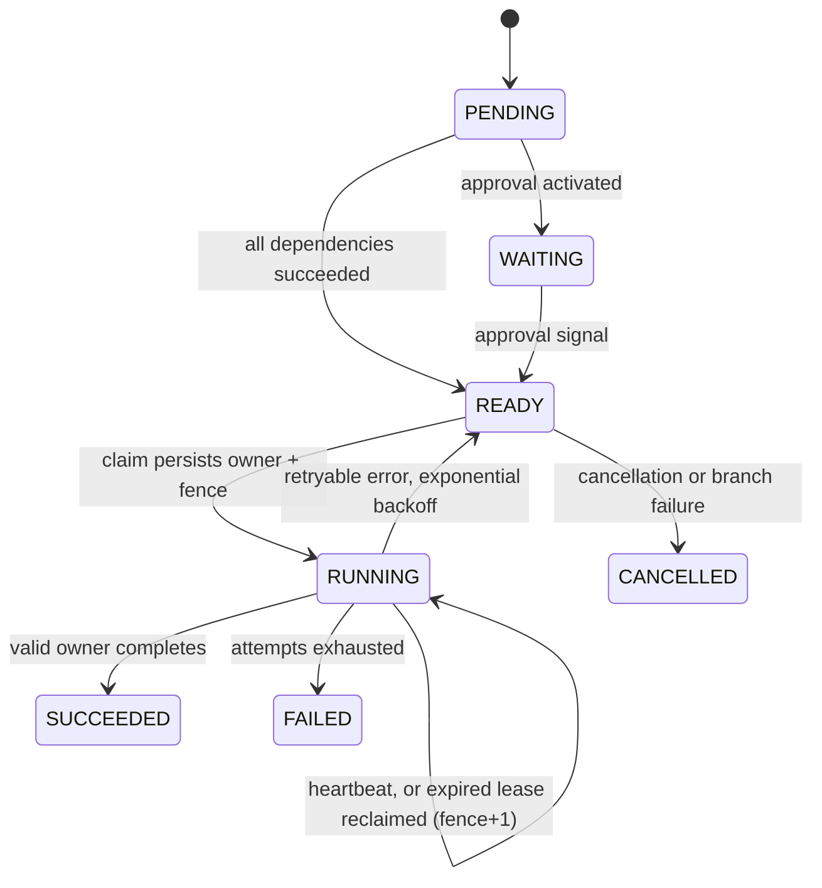

# Correctness model and limits

## Layout

| Package | Responsibility |
|---|---|
| `core` | `Workflow` (pure state machine: validation, activation, claim, complete, compensation), `Json` (strict codec), `Claim`, interfaces |
| `journal` | `JournalEngine` and `JournalLedger`: single-writer WAL backend |
| `aws` | `DynamoEngine`, `DynamoLedger`, `PayloadStore` (S3), outbox relay, counters, resource bootstrap |
| `worker` | Embedded workers, HTTP remote worker, SQS workers |
| `web` | Spring MVC controllers, auth/origin/load-shedding filter, error mapping |
| `console/` | React + TypeScript operator console, bundled into the jar |

Both storage backends call the same `Workflow` functions on a private copy of the execution projection. Storage decides only how that copy becomes durable and how resulting work is dispatched.

## Task state machine

A completion is accepted only when the execution and task are live, owner and fence match, and the lease has not expired. Reclaim increments attempt and fence. Backoff doubles from the step's base delay and caps at one hour; jitter is not implemented.

`idempotencyKey = executionId + "/" + taskId` stays constant across attempts. Compensation uses a `$undo:` task namespace that user step IDs cannot occupy.

## Journal backend

**Durable boundary.** A single writer thread executes commands against speculative in-memory state, appends each resulting transition as a frame (`length | JSON | CRC32C`), makes the whole batch (up to 256 commands) durable with one write, and only then replies. The journal is opened write-through (`DSYNC`: FUA writes on Windows, `O_DSYNC` on Linux) so the write itself is durable; `JOURNAL_SYNC=flush` uses write + `force(true)` instead. A start writes the full execution; every later transition writes a field-level patch (`journal/Patch.java`), and replay applies patches to rebuild byte-identical projections. WALs of full projections from earlier versions still replay. A flush failure poisons the writer; `/healthz` turns 503 and a restart replays the WAL. An incomplete final frame is truncated on replay; a complete frame with a bad checksum fails startup. A file lock prevents a second writer.

**Committed reads.** After each flush the writer publishes the batch's projections to a concurrent map. Reads (`get`, `list`, `stats`) use that map: they never queue behind `fsync`, and never see a transition that is not yet durable. Projections are copy-on-write and never mutated after commit.

**Scheduling.** Each READY task (due at `readyAt`) and RUNNING task (due at `leaseUntil`) has an entry in a due-time heap. A claim pops due entries and validates them lazily against current state; a task whose due time changed has a newer entry. A volatile `nextDue` lets callers skip the writer entirely when nothing is due. Idle workers block on a condition signalled after commits that make work due, instead of sleeping and polling.

**Handoff.** A worker's completion and its next claim run as one command, so they share one flush. This halves the durable round trips a busy worker waits for and is the main throughput gain over v0.1.

**Remote workers** long-poll `/api/worker/claim`. A poll is capped at one third of the lease: polls left by a crashed worker end before its lease can expire, so they cannot claim the reclaimable task for a dead process. (Integration testing found exactly this failure with a longer cap.)

Patch records cut the WAL to ≈ 2.7 KB per three-step workflow (from ≈ 8.1 KB with full projections). There is no compaction, and all executions stay in memory. Optional: `JOURNAL_SHARDS=N` partitions executions across N independent WALs and writers, and `-Dconductor.pipelinedCommit=true` overlaps execution with `fsync`. Both are measured as slower on the reference SSD; see [scaling](scaling.md).

## DynamoDB backend

Single table, string `pk`/`sk`:

| Item | Key | Purpose |
|---|---|---|
| Execution | `EXEC#id` / `META` | `version`, projection `body`, list-index attributes |
| History | `EXEC#id` / `EVT#0000…n` | Transition type, time, status, changed task fields |
| Submission | `SUBMIT#key` / `RESULT` | Execution ID + definition hash |
| Outbox | `OUTBOX#shard` / `dueAt#id#version#n` | SQS messages and EventBridge events owed by a transition |
| Effect | `EFFECT#key` / `EFFECT` | Example downstream ledger entry |
| Counters | `STATS#n` / `COUNTERS` | Sharded dashboard counters |
| Listing GSI | `gsi1pk = RUNS#shard`, `gsi1sk = createdAt#id` | Latest-N fan-out across 4 shards |

**Transition.** Read `META` (strongly consistent), apply the `Workflow` function, then one `TransactWriteItems`:

1. `Put META` with `version = :expected` and `version+1`;
2. `Put EVT#version+1` with `attribute_not_exists`;
3. `Put OUTBOX` items for newly READY tasks, lease checks, and lifecycle events;
4. `Update STATS#random` for exact counters (executions, per-status counts) when status changes.

On `ConditionalCheckFailed` or `TransactionConflict` the transition re-reads and retries with jittered backoff (bounded). Lease renewals replace `META` with a conditional put and are not journaled as history.

**Outbox.** After commit, the writer sends the outbox's messages/events and deletes the item. If it crashes first, a relay (every API task, every 500 ms) re-sends items older than 2 s. Dispatch is therefore at-least-once; duplicates are harmless because a claim is itself a conditional transition.

**Messages.** `ready` (claim this task when due) and `lease` (check the claim with fence *f* when its lease ends). A worker that receives one attempts the claim and gets *claimed*, *not due* (re-sent with the remaining delay), or *gone* (dropped). The message is deleted once the claim commits; a worker that dies mid-activity is recovered by the lease message, not by SQS visibility. Messages that fail five deliveries go to the DLQ.

**Timers** due within 15 minutes ride SQS `DelaySeconds`; later ones remain in the outbox, whose sort key starts with the due time, until the relay can hand them to SQS.

**Clocks.** Lease validity uses the clock of the process performing the write. Fencing keeps writes safe regardless of skew; skew can only cause an early reclaim and an extra attempt.

**Limits.** The projection must fit one item (~380 KB budget); results over 32 KiB go to S3. Hot executions (many parallel branches) see optimistic-concurrency retries. The list index is eventually consistent. `durableTransitions`, renewals, and retry counters are best-effort (flushed each second per process); execution, status, and effect counts are transactional.

## Effects and ambiguity

Fencing prevents stale orchestration writes. It cannot stop an already-started external request. The example ledger stores key and effect atomically and returns the original result to a retry; it rejects a different payload for the same key. Real integrations need the same contract from the downstream system (a payment provider's idempotency key, or a database transaction that records the key with the mutation).

If a worker repeatedly dies after an external effect and exhausts its retries, the engine cannot know whether the effect happened. An operator must reconcile it.

## Parallel failure and compensation

A permanent failure cancels pending tasks, lets running branches drain, then builds a compensation chain in reverse completion order (a valid reverse topological order). Compensation is leased, retryable work; exhaustion ends in `COMPENSATION_FAILED`. `COMPENSATED` means every *declared* undo succeeded. Cancellation stops scheduling and fences completions; it does not undo work.

## Security model

One bearer token (constant-time compare) for operators and journal workers; DynamoDB-mode workers use their IAM task role and hold no token. API requests with a foreign `Origin` are rejected. A semaphore sheds load with 429 above 256 concurrent API requests. Strict CSP with no inline script. Not implemented: TLS at the ALB, tenant isolation, RBAC, field-level redaction.
