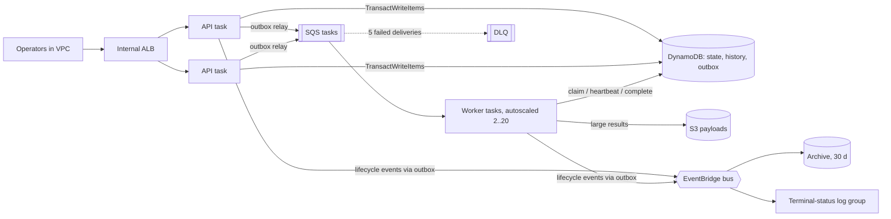

# AWS deployment

## What the CDK stack creates



- DynamoDB on-demand table with point-in-time recovery, deletion protection, retained on stack deletion; `gsi1` for listing.
- SQS work queue (SSE, TLS-only) with a dead-letter queue after five receives.
- S3 payload bucket: public access blocked, TLS-only, bucket-owner-enforced, lifecycle to Infrequent Access after 30 days.
- EventBridge bus `conductor` with a 30-day archive (replayable) and a rule logging terminal statuses.
- Two-AZ VPC; DynamoDB and S3 gateway endpoints; private Fargate tasks.
- API service: 2 stateless tasks behind an internal ALB, rolling deployments with overlap (no single writer).
- Worker service: 16 concurrent workers per task, step-scaled 2..20 tasks on queue backlog. Workers have no API token.
- Alarms: oldest-message age > 60 s, any DLQ message, DynamoDB throttling. Dashboard: backlog, queue age, CPU, transaction latency, alarm status.
- Secrets Manager API token for operators.

## Deploying

```sh
cd infra && npm ci && npm test && npm run synth
npx cdk bootstrap        # once per account/region
npx cdk diff
npx cdk deploy           # creates billable resources (NAT gateway, ALB, Fargate, DynamoDB, …)
```

The endpoint is internal. Run checks from a host in the VPC (for example an ECS Exec session or a small EC2 instance):

```sh
API_TOKEN=$(aws secretsmanager get-secret-value --secret-id <TokenSecretArn> --query SecretString --output text)
python scripts/smoke_test.py http://<InternalEndpoint>
python scripts/load_test.py http://<InternalEndpoint> --workflows 5000 --clients 64 --poll-ms 250 \
  --label "ECS 2 api + N workers, on-demand table" --out benchmarks/aws-5000.json
```

`cdk destroy` retains the table, bucket and log groups by design; delete them separately when finished.

## Status

The stack has **not been deployed** from this repository: the development machine's AWS credentials were invalid. The backend itself has been exercised against LocalStack 4.4 (unit-level `DynamoEngineIT`, the full HTTP/process integration test, and a Docker topology with two API and two worker replicas). LocalStack serializes DynamoDB transactions (12 ms alone, ~160 ms each at 16 concurrent callers), so its throughput says nothing about AWS.

## What to validate on AWS before making claims

1. Smoke test passes through the ALB; kill a worker task mid-activity and confirm reclaim.
2. Load test at fixed task sizes; record queue age, transaction latency, conflicts (`contentionRetries`), throttles, and cost per 1,000 workflows.
3. Force the outbox path: block SQS egress for one API task, confirm the relay delivers once restored.
4. Redrive a DLQ message and confirm it is dropped harmlessly or completes.
5. Restore the table from PITR into a new table and point a stack at it.
