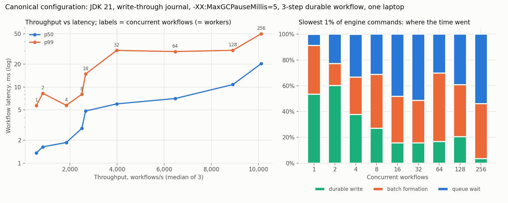
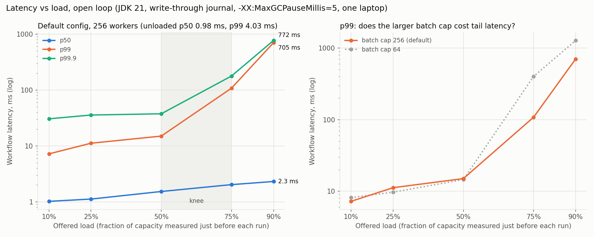

# Benchmark report

## Two numbers

| | |
|---|---|
| **Peak throughput** | **10,100 durable workflows/s** at 256 concurrent workflows (p99 50 ms) |
| **Latency at one concurrent workflow** | **p50 1.36 ms, p99 5.7 ms** |

**Conditions, stated once:**
- **Runtime:** JDK 21 (`-XX:MaxGCPauseMillis=5`), one JVM.
- **Machine:** 4-core / 8-thread laptop (i5-11300H) with a consumer NVMe SSD (Samsung PM991a, no power-loss protection), Windows 11.
- **Engine:** write-through journal, shipped defaults.
- **Workload:** three steps per workflow, two of them durable effects in a separately journaled ledger. Every transition and effect is durable before it is acknowledged.
- **Method:** closed loop with workers = concurrent workflows; median of 3 runs, each in a fresh JVM, warm-up excluded. Both numbers come from the same sweep (`benchmarks/scaling/canonical-curve`).

**Every other number in this repository is for explanation, not for quoting** (see the last section).

## The throughput-latency curve

Concurrency (= workers) is the knob that moves along the curve:

| Concurrent | Throughput (wf/s) | p50 | p99 | Batch size p50 / p99 |
|---:|---:|---:|---:|---:|
| 1 | 574 | 1.36 ms | 5.7 ms | 1 / 2 |
| 2 | 844 | 1.64 ms | 8.3 ms | 2 / 4 |
| 4 | 1,842 | 1.87 ms | 5.8 ms | 4 / 8 |
| 8 | 2,501 | 2.86 ms | 8.0 ms | 6 / 16 |
| 16 | 2,662 | 4.84 ms | 14.9 ms | 16 / 32 |
| 32 | 3,979 | 6.01 ms | 30.4 ms | 17 / 64 |
| 64 | 6,464 | 7.07 ms | 29.3 ms | 64 / 128 |
| 128 | 8,911 | 10.8 ms | 30.5 ms | 128 / 256 |
| 256 | **10,116** | 20.4 ms | **50.3 ms** | 16 / 256 |

From 32 to 128 concurrent, throughput more than doubles while p99 stays at ~30 ms. Past 128, the last 14% of throughput costs a 1.7× higher p99.

## What the tail is

Every journal command records where its time went:
- **queue wait:** from submission until the writer runs it, including waiting out a flush already in progress, i.e. "arrived just after a batch closed";
- **batch formation:** until its batch starts writing;
- **write:** the durable write itself.

| Concurrent | Slowest 1% of engine commands: queue / formation / write | Formation p99, measured / predicted | Queue p99, measured / predicted |
|---:|---|---:|---:|
| 1 | 9% / 38% / **53%** | 0.34 / 0.09 ms | 0.09 / 0.72 ms |
| 2 | 23% / 17% / **60%** | 0.41 / 0.16 ms | 0.40 / 1.17 ms |
| 16 | **48% / 36%** / 16% | 3.01 / 1.02 ms | 2.59 / 2.56 ms |
| 32 | **51% / 33%** / 16% | 3.22 / 1.56 ms | 4.01 / 3.35 ms |
| 64 | **30% / 53%** / 17% | 4.16 / 2.29 ms | 2.66 / 3.72 ms |
| 128 | **39% / 40%** / 20% | 8.45 / 3.66 ms | 8.57 / 4.94 ms |
| 256 | **54% / 43%** / 4% | 12.12 / 3.64 ms | 14.04 / 4.80 ms |

The predictions use only batch size and measured per-command execution cost (14–46 µs, falling as batches grow):
- formation ≈ p99 batch size × execution cost per command;
- queue ≈ one full batch ahead, plus one write.

**What the table shows:**
- **At 1–2 concurrent, the tail is the device write.** About 0.6–1 ms of write-time variance on the SSD.
- **From 16 up, the tail is batching.** Queue wait plus formation is 75–96% of the slowest commands' time. Queue wait matches the batching prediction closely through 32 concurrent. Formation runs 2–3× the naive estimate at every level, because the estimate counts command execution but not encoding or OS scheduling of the writer thread. So the tail is predictable from batch size to within that factor.
- **At 128–256, batching is inflated by pauses.** GC pauses take 4–7% of wall time at these loads (332–663 ms per run, longest 9–12 ms). A pause freezes the writer while up to 512 virtual threads keep submitting; the backlog then drains in full 256-command batches. That is why p99 batch size hits the cap and why measured queue/formation exceed the prediction by 2–3×.
- **The batch cap is the knob for this:** formation per batch is bounded at roughly cap × per-command cost (≈ 3.6 ms at 256). The open-loop study below shows that at high load, a larger cap still gives a *lower* p99 than cap 64, because it drains a post-pause backlog in fewer batches.

## Latency under open-loop load

Closed loop shows latency at a given concurrency. Open loop shows what happens as *arrival rate* approaches capacity:
- Workflows arrive at a fixed rate, and latency is measured from intended arrival time, so there is no coordinated omission.
- Each rate is a fraction of capacity measured immediately before the run.
- 256 workers; 3 runs; `benchmarks/latency/canonical`.

| Offered load | p50 | p99 | p99.9 | p99 with batch cap 64 |
|---:|---:|---:|---:|---:|
| 10% | 1.02 ms | 7.2 ms | 31 ms | 8.1 ms |
| 25% | 1.12 ms | 11.2 ms | 36 ms | 9.7 ms |
| 50% | 1.53 ms | 15.0 ms | 38 ms | 14.5 ms |
| 75% | 2.03 ms | 108 ms | 178 ms | 401 ms |
| 90% | 2.31 ms | 705 ms | 772 ms | 1,281 ms |

**The knee is between 50% and 75% of capacity; run at or below ~50% for a p99 in the tens of milliseconds.** Pause attribution in these runs agrees with the decomposition above:
- At 90% load, 100% of the slowest workflows overlapped a GC pause.
- The closer load is to capacity, the less spare capacity there is to drain each pause's backlog.

**Why the open-loop capacities (5.0–5.7k/s) are lower than the 10.1k peak.** The open-loop runs happened while the SSD was in its sustained-write state, at ~1.5–2.4 ms per write against ~0.7 ms in the curve run. Throughput on this laptop moves with that state (see [scaling](scaling.md#method)), which is why every run records a disk probe and why fractions of *just-measured* capacity are compared, not absolute rates across days.

## GC tuning

`-XX:MaxGCPauseMillis=5` (now the shipped JVM setting) cut p99 at 2,000/s from 14–20 ms to 8–9 ms, with equal p50 and CPU (`benchmarks/latency/gc-tuning`). Generational ZGC doubled p50 on this 4-core machine and did not improve the tail.

## Durability

These are write-through numbers on a drive without power-loss protection. See [durability](durability.md):
- **Verified:** the OS guarantee, and that the drive does real extra work for FUA writes (57–66 µs vs 4 µs cached).
- **Not verified:** power-loss survival. This is the same trust the previous flush-based journal already placed in the drive.

## Other figures in this repository, and why they are not quoted

| Figure | Where | Conditions | Purpose |
|---|---|---|---|
| 2,499 → 6,885 wf/s | [scaling](scaling.md) | before/after engine changes, 256 workers, 1,024 clients, **flush** journal, default GC | shows where the old engine flattened |
| 20 → 2,666 wf/s | [scaling](scaling.md) | 10 ms simulated activities, flush journal | worker-pool scaling |
| 4.87 → 4.24 → 1.12 ms p50 | [scaling § Latency](scaling.md#latency) | 1 client, 8 workers, default GC | effect of direct grants, then write-through |
| +38% / +22% | [scaling § Latency](scaling.md#latency) | flush vs write-through at 64 / 256 workers | effect of write-through on throughput |
| 55 → 280 wf/s | [scaling](scaling.md) | 1–8 worker processes over HTTP, flush journal | remote-worker protocol cost |
| 6,651 wf/s | `benchmarks/latency/canonical` | 1,024 clients, SSD in its sustained (slow) state | capacity reference for the open-loop study |
