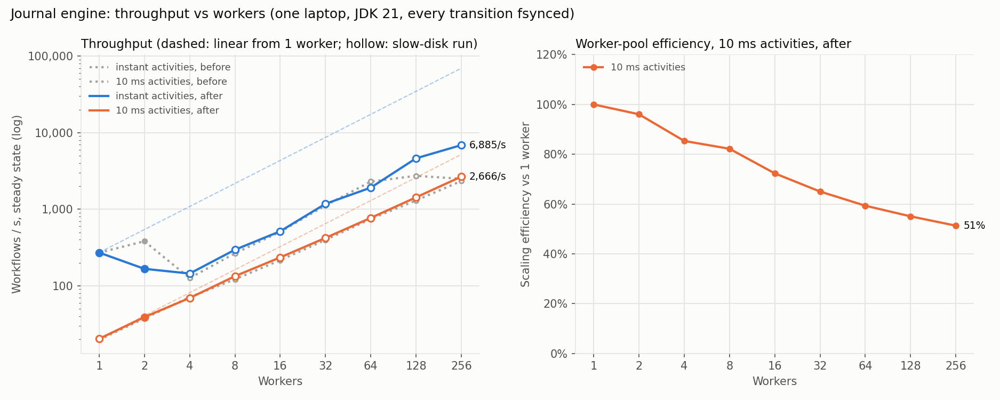

# Scaling study: throughput vs worker count

**Question:** does durable throughput scale with workers, and if not, where does it flatten and why?
**Short answer:**
- **Workers that wait on a downstream call** (10 ms activities): throughput keeps rising to 256 workers, 20 → 2,666 workflows/s, at 51% efficiency against linear.
- **Workers with nothing to wait on** (instant activities): workers aren't the resource. Throughput is set by how many transitions each `fsync` carries. The optimized engine keeps growing that batch and reaches **6,885 workflows/s at 256 workers, 2.75× the previous engine**, which flattened at ~2.7k because its batch was capped at 64.

Everything here is **one laptop**. The multi-process results add separate JVMs and real HTTP, but not separate hosts or a network. No AWS numbers are claimed.

## Method

- **Workload.** Three-step workflow: two ledger effects (a downstream service with its own durable log), then an echo. Every engine transition and every new effect is `fsync`ed before acknowledgment.
- **Two regimes.**
  - *Instant activities*, where workers do no work of their own, so this measures the durability path.
  - *10 ms activities* (`latencyMs=10` on every step), which simulate calls to downstream services, the case a worker pool exists for.
- **Load.** Closed loop: `max(64, 4 × workers)` concurrent clients each submit, wait for completion (commit-signalled `awaitTerminal`, no polling), and repeat, so the worker pool is always the limit.
- **Measurement.**
  - Steady-state throughput between the 10th and 90th percentile completion times (ramp-up and drain excluded).
  - Every run in a fresh JVM, 3 repetitions, median reported, all raw runs kept.
- **Before / after.** "before" is the previous engine reproduced by switches (`-Dconductor.batchSize=64 -Dconductor.deepCopyTransitions=true -Dconductor.fullProjectionRecords=true`); "after" is the current default.
  - The two configurations are interleaved inside every repetition, so slow drift in the machine hits both alike.
- **Disk state recorded per run.** A 1-thread `fsync` probe runs before every benchmark. The chart shows runs taken while the disk was in its slow state (probe > 1.5 ms) as hollow markers.
- **Machine.** Intel Core i5-11300H (4 cores / 8 threads), Samsung MZVLQ512 NVMe SSD (DRAM-less, NTFS), Windows 11, on AC power, kept awake by the sweep. **JDK 21.0.2**, the Docker/CI runtime.
- **Reproduce:**
  1. `./mvnw -Dconsole.skip=true -DskipTests test-compile`
  2. `python scripts/scaling_sweep.py --label final --config "before=…" --config "after="`
  3. `python scripts/plot_scaling.py benchmarks/scaling/final --highlight after --out docs/scaling.svg`

## Results

### Instant activities: the durability path

| Workers | Before (wf/s) | After (wf/s) | After vs before | After mean batch | Disk probe (ms) |
|---:|---:|---:|---:|---:|---:|
| 1 | 271 | 272 | +0% | 1.3 | 0.68 |
| 2 | 382 | 167 | (disk) | 1.8 | 0.83 |
| 4 | 126 | 145 | +15% | 2.5 | 2.24 |
| 8 | 266 | 296 | +11% | 5.1 | 2.42 |
| 16 | 506 | 516 | +2% | 9.6 | 2.19 |
| 32 | 1,121 | 1,178 | +5% | 20.0 | 2.21 |
| 64 | 2,297 | 1,915 | (disk) | 41.8 | 2.02 |
| 128 | 2,735 | **4,628** | **+69%** | 90.2 | 2.32 |
| 256 | 2,499 | **6,885** | **+176%** | 181.1 | 2.20 |

**Why it behaves this way:**
- **Throughput ≈ commands per flush ÷ `fsync` time.** Workers matter only because more of them put more commands into each group commit. From 4 to 128 workers throughput roughly doubles with each doubling of workers, and the mean batch doubles with it.
- **The old engine flattens because its batch cap binds.** At 128 workers its mean batch is 63.5 against a cap of 64. More workers then only add queueing, and throughput falls at 256.
- **The new engine scales on two changes.** The cap is 256, and each record is a patch of the fields that changed, so the WAL carries 2,730 bytes per workflow instead of 8,130 and each flush costs less.
- **Rows marked "(disk)" are noise, not regressions.** Within each configuration, throughput tracks the engine's measured `fsync` latency exactly. At 64 workers, "after" reps drew 3.5, 4.3 and 4.5 ms flushes and did 2,585, 1,915 and 1,754 wf/s. Compared at equal `fsync` latency (~3.47 ms), after beats before 2,585 vs 2,297 (+12%). At 2 workers the "before" reps happened to run on the fast disk.

### 10 ms activities: the worker pool

| Workers | Before (wf/s) | After (wf/s) | After efficiency vs 1 worker | After p99 (ms) |
|---:|---:|---:|---:|---:|
| 1 | 20 | 20 | 100% | 3,363* |
| 2 | 38 | 39 | 96% | 1,744* |
| 4 | 71 | 69 | 85% | 1,104* |
| 8 | 122 | 134 | 82% | 555 |
| 16 | 216 | 235 | 72% | 386 |
| 32 | 397 | 422 | 65% | 370 |
| 64 | 747 | 771 | 59% | 533 |
| 128 | 1,304 | 1,430 | 55% | 509 |
| 256 | 2,338 | **2,666** | **51%** | 641 |

\* The closed loop keeps 64 clients against very few workers, so p99 there is client queueing, not engine latency.

**Where the efficiency goes.** These are per-step timings recorded by the workers themselves (`benchmarks/scaling` runs with step anatomy; disk in its fast state, `fsync` ≈ 1.1 ms):

| Workers | Step time | Activity (10 ms sleep + effect) | of which: ledger effect | Commit wait (completion + next claim) |
|---:|---:|---:|---:|---:|
| 1 | 15.7 ms | 14.3 ms | 1.3 ms | 1.2 ms |
| 64 | 16.2 ms | 13.2 ms | 1.4 ms | 2.5 ms |
| 256 | 28.5 ms | 23.7 ms | 1.7 ms | **6.4 ms** |

- **The engine's own scaling cost is the commit wait: 1.2 → 6.4 ms.** A step that arrives while a flush is in progress waits for it, then for its own. Larger batches also take slightly longer to write. That's the price of group commit, and it's what buys the throughput above.
- **Neither writer is saturated.** At 256 workers the engine writer spends 31–38% of wall time in `fsync` and the ledger ~20%, so there's headroom before the disk is the limit.
- **The rest is a benchmark artifact: the simulated 10 ms activity itself stretches to ~22 ms.**
  - Windows wakes timers on a ~15.6 ms tick. A pure JDK 21 test shows `sleep(10)` costs 15.5 ms at any concurrency, and a sleep that starts at a random point in the tick waits for a later boundary.
  - Real downstream calls that are I/O-bound wouldn't inherit this quantization, so the efficiency above is conservative for the engine.

### Multiple processes: coordinator + worker JVMs over HTTP

`ClusterBenchmark` starts one coordinator JVM (`WORKERS=0`) and P independent worker JVMs (`CONDUCTOR_ROLE=worker`, 4 workers each). They talk only through the worker HTTP protocol: long-poll claim, effect call, and complete-and-claim-next. A Java load generator drives the public API. Raw files: `benchmarks/scaling/cluster/`. 2 repetitions per point.

| Worker processes (workers) | 10 ms activities (wf/s) | Instant activities (wf/s) | CPU threads busy, all processes: 10 ms / instant (of 8) |
|---:|---:|---:|---:|
| 1 (4) | 55 | 325 | 1.3 / 5.8 |
| 2 (8) | 114 | 237 | 2.4 / 6.5 |
| 4 (16) | 187 | 267 | 4.8 / 7.0 |
| 8 (32) | 280 | 239 | 6.4 / 7.2 |

- **10 ms activities scale across processes:** 2.06× from 1 to 2 worker processes, then 1.64× and 1.50×. The knee is this laptop. With 8 worker JVMs, a coordinator and a load generator, the processes use 6.4 of 8 hardware threads. Separate hosts would remove exactly this limit, which is why the next step is a multi-host run, not more processes on one box.
- **Instant activities are flat at ~240–325 wf/s and CPU-bound** (5.8–7.2 threads busy). Every step now costs three HTTP round trips plus JSON on both ends. In-process, the same engine does 5,000+. The protocol, not the durability path, is the remote-worker bottleneck, and the obvious next optimization is a batched claim/complete call, so one round trip carries many tasks.
- **The same 32 workers do 422 wf/s in-process and 280 as separate JVMs** (10 ms activities): that's the cost of process isolation on one machine.

## Latency

**Unloaded, latency is serial `fsync`s.** With one client, one three-step workflow (two effects) paid about **7 durable flushes in series**: start, first claim, then effect and complete-and-claim-next twice, then the final completion. At ~0.65 ms per `fsync` on this SSD, that accounts for nearly all of the measured ~4.9 ms p50. CPU is not the issue; the number of round trips in series is.

**Direct grants.** Previously an idle worker was woken after a start became durable and then spent a flush of its own claiming the task. Now idle workers park inside the engine, and the writer assigns them due tasks *in the same batch* that made the tasks due. Start and first claim share one `fsync`, and a grant is released only once durable. The previous wake-then-claim path stays available as `-Dconductor.directGrant=false`.

Interleaved, 5 reps each, JDK 21, 8 workers, instant activities, microsecond timing (`benchmarks/latency/`):

| Concurrent clients | p50 wake-then-claim | p50 direct grant | p99 wake-then-claim | p99 direct grant |
|---:|---:|---:|---:|---:|
| 1 | 4.87 ms | **4.24 ms (−13%)** | 9.42 ms | **8.27 ms (−12%)** |
| 4 | 7.53 ms | **6.71 ms (−11%)** | 14.24 ms | **13.37 ms (−6%)** |

Engine `fsync`s per workflow at 1 client: 4.85 → 4.00.

**What remains.** About 6 serial `fsync`s × 0.65 ms ≈ 3.9 ms of the 4.24 ms p50. Each one is a durability point the engine promises:
- a start is durable before it's acknowledged;
- an effect is durable in the ledger before its completion is recorded;
- a step starts only after its dependencies have durably succeeded.

Going lower means relaxing one of those promises, and that was deliberately **not done**:
- *Speculative next step* (start step N+1 while step N's completion is still flushing) would save ~2 flushes per workflow (≈ −30%). The cost: step N+1's side effects could happen before step N's success is durable. If the coordinator then crashed and step N failed on retry, a downstream system would see effects out of causal order.
- *Asynchronous effect acknowledgment* would remove the ledger flushes from the critical path but break effect-before-completion.

Hardware is the other lever: a server SSD with power-loss protection acknowledges `fsync` in tens of microseconds instead of ~0.65 ms, which would shrink this whole budget about tenfold without changing any semantics.

## Things that were tried and rejected (all JDK 21, interleaved)

| Option | Effect | Status |
|---|---|---|
| Pipelined commit (overlap execution with `fsync`) | −6% at 4 workers, −7% at 16, +1% at 128 | opt-in `-Dconductor.pipelinedCommit=true` |
| Partitioned journal, 2 shards | −24% at 4 workers, −11% at 128 | opt-in `JOURNAL_SHARDS` |
| Partitioned journal, 4 shards | −27% at 4 workers, −53% at 128 | opt-in |
| Preallocated WAL segments | no consistent `fsync` gain | rejected |

**Partitioning loses because of how this SSD flushes.** Concurrent `fsync`s on separate files do raise aggregate flush rate (453/s with 1 thread → 1,244/s with 8 on this SSD, `FsyncProbe`), but splitting the load shrinks every writer's batch more than that. On hardware where parallel flushes are nearly free (separate devices, enterprise NVMe with power-loss protection) the trade-off may invert, which is why it stays available and is tested.

## Measurement pitfalls found along the way

1. **JDK 25.0.2 virtual-thread timers (JDK-8370887).** Cancelling timed parks early (long polls, idle-worker waits) corrupted the timer heap, and 10 ms sleeps woke after up to 10 s. Repro without project code: JDK 25.0.2 worst 9,991 ms; JDK 21.0.2 17 ms; Temurin 25.0.4.1 25 ms. Every JDK 25.0.2 measurement was discarded, and the service now warns at startup on affected JDK 25 builds.
2. **Sleep and standby.** The laptop ran on battery in Modern Standby for most of one afternoon of sweeps, and a run "stalled" for 7 minutes across a system sleep. The sweep now holds a keep-awake request and pauses while on battery.
3. **Disk drift.** `fsync` latency on this DRAM-less NVMe moves between ~0.65 ms (after idle) and ~2.4 ms (sustained writing). Hence interleaving and the per-run probe.
4. **The harness can be the bottleneck.** A single-threaded submitter, and later 0.2 ms status polling by hundreds of clients, each masked engine improvements before being replaced.

## What would extend this

- **A multi-host run.** Workers on separate machines would remove the shared-CPU knee seen in the multi-process sweep. This is the next measurement; `scripts/load_test.py` and `ClusterBenchmark` already work against a remote coordinator.
- **A batched worker protocol.** Claim and complete many tasks per round trip, attacking the remote-worker ceiling for short activities.
- **A disk whose flushes don't drift** (server NVMe with power-loss protection) to measure the group-commit ceiling without the SSD's cache behavior.
